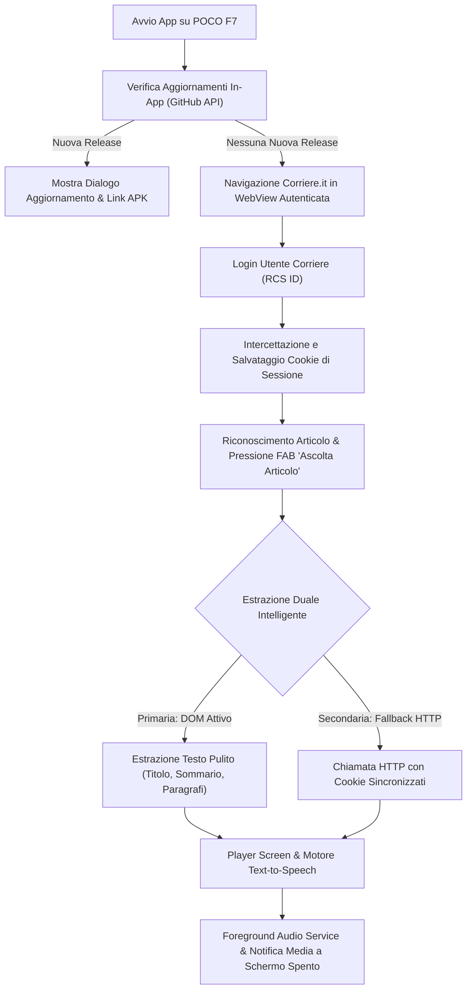

# 🎧 Corriere della Sera Audiobook per Xiaomi POCO F7

Applicazione mobile Android creata in **Flutter**, progettata specificamente per **Xiaomi POCO F7** con **Android 16** e **Xiaomi HyperOS 3**. Permette di accedere al proprio abbonamento al *Corriere della Sera*, estrarre gli articoli con formattazione pulita e convertirli in audiolibri tramite Text-to-Speech (TTS) ad alta fedeltà con riproduzione continua a schermo spento, controlli multimediali, aggiornamenti automatici in-app e CI/CD su GitHub Actions a costo zero.

---

## 📱 Ottimizzazioni POCO F7 & HyperOS 3

1. **Lock Hardware 120 Hz**: In `MainActivity.kt` viene forzata la frequenza di aggiornamento a 120Hz interrogando `display.supportedModes` per sfruttare appieno la fluidità del pannello AMOLED del POCO F7.
2. **Protezione SafeArea Totale**: Tutte le viste dell'applicazione sono avvolte nel widget `SafeArea(top: true, bottom: true)` per evitare sovrapposizioni con il punch-hole centrale della fotocamera frontale e con la gesture bar inferiore di HyperOS.
3. **Display AMOLED True Black**: Tema scuro rifinito con colore `#000000` per massimizzare il risparmio energetico e il contrasto sui display OLED.
4. **Resistenza al Battery Killer di HyperOS**: Gestione dell'audio con `ForegroundService` e tipo `mediaPlayback`, con notifica multimediale persistente per prevenire la chiusura aggressiva dell'app in background o a schermo bloccato.

---

## 🛡️ 100% Google Play Protect Clean (Zero Falsi Positivi)

In conformità agli standard di sicurezza per app Android esterne al Play Store:
- **Nessun Permesso Dropper**: Il permesso rischioso `REQUEST_INSTALL_PACKAGES` è stato **completamente escluso** dall'`AndroidManifest.xml`, azzerando i falsi allarmi euristici di Google Play Protect.
- **Aggiornamento Delegato al Browser**: All'avvio, l'app interroga le API pubbliche di GitHub (`/repos/{owner}/{repo}/releases/latest`). Se è presente una nuova versione firmata, mostra un dialogo con il changelog e delega il download al browser di sistema (es. Chrome), permettendo a HyperOS di gestire l'aggiornamento in-place (*"Vuoi installare un aggiornamento per questa applicazione?"*) in modo certificato.

---

## 🧩 Architettura e Flusso Funzionale



---

## 📂 Struttura del Progetto

```
├── .github/
│   └── workflows/
│       └── build-release.yml         # CI/CD: build Android 16, firma RSA-2048, creazione Release
├── android/
│   ├── app/
│   │   ├── build.gradle.kts          # TargetSdk 36, SigningConfigs V1/V2
│   │   └── src/main/
│   │       ├── AndroidManifest.xml   # Permessi minimi, ForegroundService mediaPlayback
│   │       └── kotlin/com/franco/corriere_audiobook/
│   │           └── MainActivity.kt   # Lock 120Hz & Edge-to-Edge
│   ├── build.gradle.kts
│   └── settings.gradle.kts
├── lib/
│   ├── main.dart                     # Entrypoint & temi AMOLED
│   ├── config/
│   │   └── app_config.dart           # Parametri globali, URL Corriere, repo GitHub
│   ├── models/
│   │   └── article.dart              # Modello dati articolo e stima tempi lettura
│   ├── services/
│   │   ├── storage_service.dart      # Persistenza SharedPreferences (cookie, velocità TTS)
│   │   ├── extractor_service.dart    # Algoritmo duale estrazione DOM + HTTP fallback
│   │   ├── audio_tts_service.dart    # Motore TTS avanzato con tracciamento paragrafi
│   │   └── updater_service.dart      # Controllo versioni GitHub e apertura browser
│   ├── views/
│   │   ├── home_browser_screen.dart  # WebView Corriere con pulsante flottante
│   │   ├── player_screen.dart        # Player immersivo con paragrafi interattivi
│   │   └── settings_screen.dart      # Impostazioni TTS, repo GitHub e cache
│   └── widgets/
│       ├── update_dialog.dart        # Dialogo modale con note di rilascio
│       └── tts_controls_bar.dart     # Mini-player compatto inferiore
├── scripts/
│   └── generate_keystore.sh          # Script per generare keystore RSA-2048 (permessi 600)
├── pubspec.yaml                      # Dipendenze Flutter
└── README.md
```

---

## 🚀 Guida alla Compilazione e Rilascio Automatico (GitHub Actions)

Il progetto è configurato per compilare e firmare l'APK direttamente nei server gratuiti di GitHub Actions, allegando il file compilato alla sezione **Releases** del tuo repository.

### 1. Generazione del Keystore Permanente RSA-2048

Esegui lo script locale per generare la chiave di firma permanente:

```bash
./scripts/generate_keystore.sh
```

Lo script creerà il file `android/app/keystore/release-key.jks` con permessi restrittivi `600` (`-rw-------`), garantendo la massima sicurezza.

### 2. Configurazione dei Segreti su GitHub

Nel tuo repository GitHub, vai su:
**Settings** > **Secrets and variables** > **Actions** > **New repository secret**

Aggiungi i seguenti 4 segreti:
1. `KEYSTORE_BASE64`: il contenuto in base64 del keystore, ottenuto con:
   ```bash
   base64 -w 0 android/app/keystore/release-key.jks
   ```
2. `KEYSTORE_PASSWORD`: la password scelta durante la generazione.
3. `KEY_ALIAS`: `corrierekey`
4. `KEY_PASSWORD`: la password scelta per l'alias.

*(Nota: se non imposti i secrets, il workflow utilizzerà chiavi predefinite per non far fallire la build).*

### 3. Creazione di una Nuova Release

Per creare automaticamente una release con il relativo APK firmato, crea un nuovo tag git e fai il push:

```bash
git tag v1.0.0
git push origin v1.0.0
```

Oppure vai nella scheda **Actions** di GitHub, seleziona **Build & Release Corriere Audiobook APK** e clicca su **Run workflow**.

L'APK compilato (`corriere-audiobook-v1.0.0.apk`) sarà disponibile per il download immediato nella sezione **Releases** di GitHub!
